# Mazin Sbeih

**Worked in banks. Sold to banks. Now I build for them.**

[LinkedIn](https://www.linkedin.com/in/mazin-sbeih)

Read this page as text

### The control layer
A governance system I built around AI coding agents, so one person can ship compliance-grade software fast without taking the agent's word for anything. Agents propose, hooks and scripts enforce the rules, and a human makes the calls that matter.

**The value**
- **Speed without blind trust.** Agents write the code. Scripts, not the agent, decide whether it passes.
- **An audit trail by default.** Every change carries a scoped proposal, a failing test written first, a review note, and a human approval.
- **Mistakes stopped before they land.** Source edits are blocked until a failing test exists, destructive git commands need confirmation, and agents cannot merge.

**Use cases**
- Banks and credit unions adopting AI coding agents under risk and compliance scrutiny.
- Fintech and stablecoin teams writing payment, ledger, and sanctions code that has to survive bank due diligence.
- AI adoption teams that need working guardrails for agentic development, not just a policy document.

**Why it's different**

| Most AI coding setups | This control layer |
|---|---|
| Rules live in a prompt the agent can ignore or forget | Rules are enforced by hooks and scripts the agent cannot skip |
| "Done" is whatever the agent says | "Done" means the verify script exited clean, with its output shown |
| Tests and review happen after the code is written | Code edits are blocked until a failing test is recorded and approved |
| Agents can push and merge on their own | Only a human merges, and pushes to main need approval |
| Every change gets the same level of trust | Risk-tiered: low-risk docs changes move with fewer stops; anything touching money, sanctions, or the ledger stops at human gates |
| Compliance numbers come from memory | Every regulatory threshold must cite its primary source, or the check fails |

**About me**
- **Inside banks (2016 to 2021):** Wells Fargo, Bank of the West, U.S. Bank.
- **Selling to banks (2021 to 2026):** Alkami, Amount, Array: digital banking, lending, and identity platforms.
- **Building for banks (now):** stablecoin settlement infrastructure (non-custodial, fail-closed sanctions screening, double-entry ledger) and this control layer.
- **AI toolkit:** Claude Code, OpenAI Codex, GitHub Copilot, CodeRabbit, ChatGPT, Obsidian.

